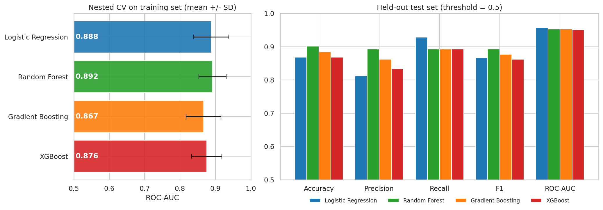

# MedPredict

**Can a small, historical heart-disease dataset support reliable predictions?**

MedPredict explores that question by comparing four machine-learning models on the UCI Cleveland Heart Disease dataset. The project emphasizes careful evaluation: preprocessing stays inside the training pipeline, model selection uses nested cross-validation, and the final comparison uses a held-out test set only once.

> **Research and education only.** This project is not a medical device. Its predictions must not be used to diagnose, screen, or guide treatment. The dataset is small, historical, and not representative of a general screening population.

## At A Glance

| Dataset | Evaluation | Best nested-CV ROC-AUC | Models |
|---|---|---:|---|
| 303 patients, 13 features | 5-fold CV, 3 repeats | 0.892 +/- 0.039 | Logistic Regression, Random Forest, Gradient Boosting, XGBoost |

The Random Forest was selected by the pre-set nested-CV ROC-AUC rule. Its score is close to Logistic Regression's 0.888 +/- 0.050, so the results do **not** establish a clear winner.

## Results

Cross-validation is the more conservative estimate for this small dataset. The higher scores on the 61-patient test set should be interpreted cautiously.

| Model | CV ROC-AUC (mean +/- SD) | CV F1 (mean +/- SD) | Test accuracy | Test recall | Test ROC-AUC |
|---|---:|---:|---:|---:|---:|
| Logistic Regression | 0.888 +/- 0.050 | 0.804 +/- 0.058 | 0.869 | 0.929 | 0.958 |
| **Random Forest** | **0.892 +/- 0.039** | 0.783 +/- 0.065 | **0.902** | 0.893 | 0.953 |
| Gradient Boosting | 0.867 +/- 0.049 | 0.782 +/- 0.064 | 0.885 | 0.893 | 0.953 |
| XGBoost | 0.876 +/- 0.043 | 0.773 +/- 0.067 | 0.869 | 0.893 | 0.951 |



**How to read this:** the models are close relative to fold-to-fold variation. The test set contains only 61 patients, and its ROC-AUC values are higher than cross-validation estimates. See [test metrics and confidence intervals](results/test_metrics_ci.csv) for uncertainty details.

More evaluation outputs include [ROC](results/roc_curve.png), [precision-recall](results/pr_curve.png), [calibration](results/calibration_curve.png), [threshold analysis](results/threshold_analysis.png), and [permutation importance](results/permutation_importance.csv). Feature importance describes model behavior, not causes.

## Evaluation Design

1. Stratified 80/20 split with seed 42: 242 training patients and 61 held-out test patients.
2. Imputation, scaling, one-hot encoding, and model fitting are composed in a pipeline, fitted within each cross-validation fold to prevent preprocessing leakage.
3. Hyperparameters are tuned in 5-fold inner cross-validation. Models are compared over 5 outer folds repeated 3 times.
4. The model with the highest mean outer-fold ROC-AUC is selected before evaluating the held-out test set.
5. Test metrics, bootstrap 95% confidence intervals, threshold analysis, and permutation importance are reported after selection.

The tested models are Logistic Regression, Random Forest, Gradient Boosting, and XGBoost. A majority-class dummy classifier provides a baseline. The target is binary: no disease (`num = 0`) or disease present (`num > 0`).

## Dataset

The project uses the Cleveland Clinic Foundation subset of the [UCI Heart Disease dataset](https://archive.ics.uci.edu/dataset/45/heart+disease): 303 patients, 13 input features, and six missing values. The data are downloaded automatically on first run and are intentionally not committed to this repository. Dataset provenance, feature definitions, and citation details are in [data/README.md](data/README.md).

## Run It

Requires Python 3.12. Install the dependencies and run the complete workflow from the project root:

```powershell
python -m venv .venv
.venv\Scripts\Activate.ps1
python -m pip install -r requirements.txt
python run_all.py
```

The first run downloads the dataset. Training can take a few minutes. To run individual stages instead:

```powershell
python 1_eda.py
python 2_train.py
python 3_predict_evaluate.py
```

Saved model pipelines are in `models/`; metrics and figures are in `results/`. The matching Jupyter notebooks, with written observations, are in `notebooks/`. See [models/README.md](models/README.md) for loading a saved model.

## Project Status

| Complete | Planned |
|---|---|
| Data exploration, preprocessing, model tuning, nested-CV selection, held-out evaluation, permutation importance | SHAP explanations, Streamlit interface, probability calibration, subgroup analysis, external validation |

## Limitations

- Only 303 patients are available, including 61 in the test set; estimates are uncertain.
- The data come from one historical clinical cohort and are not representative of a general population.
- There is no external validation, and model scores are not calibrated probabilities.
- A classification threshold involves trade-offs between missed cases and false alarms; choosing one is a clinical decision, not a purely statistical one.

## Credits

Data: Janosi, Steinbrunn, Pfisterer, and Detrano; donor David W. Aha, via the UCI Machine Learning Repository. See the [UCI dataset page](https://archive.ics.uci.edu/dataset/45/heart+disease) and [data documentation](data/README.md) for the full citation.
